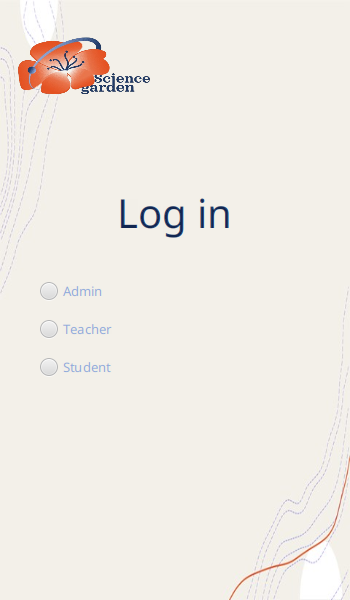
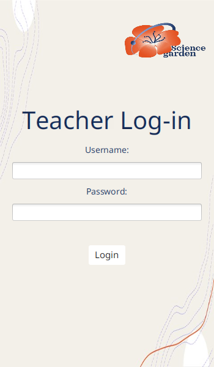
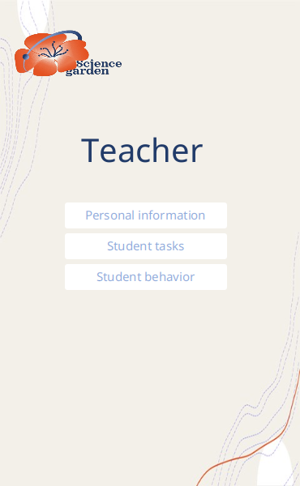

# Kindergarten Management System – "Science Garden"

> A JavaFX desktop app for a kindergarten, with separate portals for admins, teachers and students/parents, plus task assignment and behaviour tracking stored in MySQL through Hibernate.

## Overview

**Science Garden** is a desktop management system for a kindergarten, built in Java with JavaFX and Hibernate ORM. A welcome screen leads to a login-type selector, and each role (Admin, Teacher, Child/Parent) gets its own login screen and dashboard.

- **Admins** manage teacher records, take teacher attendance and export it to a file, and plan school trips.
- **Teachers** view their profile and class, assign learning tasks to students, and rate each child's daily behaviour.
- **Children and parents** see the child's personal and guardian information, assigned tasks, behaviour ratings, activities and fees.

## Features

- Role-based login for **Admin**, **Teacher** and **Child**, backed by account files in `data/`
- **Teacher record and attendance**: tick present/absent per teacher for a date and export a report (`Extract->file` → `output.txt`)
- **Trip management**: publish a trip description
- **Student tasks**: a teacher assigns a title, subject, target skill and task text to a child (Hibernate entity `Task`)
- **Behaviour tracking**: daily scores for *Respect others*, *Active*, *Focus* and *Collaborate with classmates* (Hibernate entity `Behavior`)
- **Child profile**: gender, date of birth, allergies, class, guardian name, relation and phone, and special-treatment notes
- A consistent, child-friendly JavaFX UI (custom colours and Comic Sans styling)

## Tech Stack

- **Java 8** with **JavaFX** (NetBeans 8.2 JavaFX project, Ant build)
- **Hibernate ORM 4.3** with JPA annotations
- **MySQL** (Connector/J 8.0.18). Apache Derby client libraries are also referenced.

## Screenshots

| Welcome | Choose role | Teacher login | Teacher dashboard |
|---|---|---|---|
|  |  |  |  |

## Getting Started

### Prerequisites
- JDK 8 with JavaFX (for example Oracle JDK 8 or Zulu/Liberica JDK 8 *FX*). Alternatively, use a newer JDK with OpenJFX added to the module path.
- NetBeans 8.2 or later (Ant-based project), or any IDE that can run Ant
- MySQL 5.7+/8.x
- The JARs listed in [`lib/README.md`](lib/README.md)

### Setup
1. **Database:** create the schema:
   ```bash
   mysql -u <user> -p < database/schema.sql
   ```
   The schema includes demo rows for the sample children. Teacher screens *update* existing rows, so add a row per child in `task` and `Behavior` before you edit.
2. **Hibernate config:**
   ```bash
   cp src/project/hibernate.cfg.example.xml src/project/hibernate.cfg.xml
   ```
   Then set your MySQL URL, user and password. `hibernate.cfg.xml` is git-ignored.
3. **Libraries:** put the MySQL connector and Derby JARs in `lib/` and make sure the Hibernate 4.x and JPA 2.1 libraries are on the classpath. See [`lib/README.md`](lib/README.md).
4. **Images:** the background and logo are in `assets/`. Optionally add a `back.png` icon; see [`assets/README.md`](assets/README.md).
5. **Run:** open the folder in NetBeans and run the project. The main class is `project.ProjectAP`. Run it from the project root so that `data/` and `assets/` resolve.

Demo logins (fictional sample data in [`data/`](data/README.md)): `admin1 / admin123`, `teacher1 / teach123`, `child1 / child123`.

## Project Structure

```
Kindergarten-Management-System-/
├── src/project/
│   ├── ProjectAP.java          # entry point – welcome screen
│   ├── LoginType.java          # choose Admin / Teacher / Student
│   ├── LoginA.java, LoginT.java, LoginS.java   # role login screens
│   ├── Admin.java              # admin dashboard (teacher record, attendance, trips)
│   ├── Teacher.java            # teacher dashboard (tasks, behaviour)
│   ├── Child.java              # child/parent dashboard
│   ├── Task.java, Behavior.java   # Hibernate entities
│   ├── HibernateUtil.java      # SessionFactory setup
│   └── hibernate.cfg.example.xml
├── data/        # sample account files (Admin.txt, Teacher.txt, Child.txt)
├── assets/      # UI images (background, logo)
├── database/    # schema.sql
├── lib/         # dependency jars (git-ignored, see README)
├── nbproject/   # NetBeans project metadata
└── build.xml
```

## Notes

- Accounts are read from plain-text files and compared in plain text. That is fine for a classroom prototype, but a real deployment would move users into the database and hash passwords.
- The teacher-attendance screen lists five placeholder teacher names.

## Credits

Team project. Source files credit teammates as co-authors (`@author` tags).
Built by **Hala Jalal** with teammates as a university project at Umm Al-Qura University.

## License

[MIT](LICENSE) © 2025 Hala Jalal
